# pfsense-firewall-traffic-analysis
Hands-on pfSense firewall configuration, TCP/IP troubleshooting, and Wireshark packet analysis using VirtualBox.
# pfSense Security Homelab — Part 3: Firewall Security Monitoring & Network Traffic Analysis

## Project Overview

This project demonstrates hands-on network security monitoring, firewall troubleshooting, and packet analysis using pfSense, Ubuntu Linux, Kali Linux, and Wireshark in an Oracle VirtualBox environment.

Building on my previous pfSense network configuration and DNS troubleshooting projects, I investigated how normal and unsuccessful network connections behave, examined TCP and ICMP packets, configured firewall rules, and correlated packet captures with firewall logs.

The project also includes troubleshooting a Linux web server port conflict and identifying a misconfigured pfSense firewall rule through practical testing.

**Project focus:** Networking, Linux troubleshooting, firewall administration, packet analysis, and security event investigation.

## Lab Environment

| Component | Configuration |
|---|---|
| Hypervisor | Oracle VirtualBox |
| Firewall | pfSense 2.9.0 |
| Ubuntu Linux | Client and Nginx web server |
| Kali Linux | Network testing and packet analysis |
| Packet Analyzer | Wireshark |
| pfSense WAN | VirtualBox NAT |
| pfSense LAN | Internal Network — SecurityLab |
| LAN Subnet | 192.168.50.0/24 |

### Network Addressing

| Device | Interface | IP Address |
|---|---|---|
| pfSense WAN | em0 | 10.0.2.15/24 |
| pfSense LAN | em1 | 192.168.50.1/24 |
| Ubuntu | enp0s3 | 192.168.50.100/24 |
| Kali LAN | eth1 | 192.168.50.101/24 |
| Kali NAT | eth0 | 10.0.2.15/24 |

Ubuntu used pfSense as its default gateway. Kali had a separate VirtualBox NAT interface alongside its SecurityLab interface.

Kali-to-Ubuntu traffic stayed within the same LAN, while Ubuntu's outbound traffic to external destinations passed through pfSense.

## Project Objectives

- Verify pfSense, Ubuntu, and Kali network configurations.
- Understand routing decisions and default gateways.
- Capture and analyze ICMP Echo Requests and Replies.
- Investigate the TCP three-way handshake.
- Identify TCP SYN, SYN-ACK, ACK, and RST flags.
- Troubleshoot a Linux web server port conflict.
- Compare successful and refused TCP connections.
- Configure and validate a pfSense firewall blocking rule.
- Investigate unexpected firewall behavior.
- Correlate firewall logs with packet captures.
- Identify TCP SYN retransmissions resulting from blocked traffic.

---

# Phase 1 — Network Configuration Verification

## 1.1 pfSense WAN and LAN Configuration

Verified the existing VirtualBox network configuration.

pfSense used two network adapters:

- Adapter 1: NAT for external connectivity.
- Adapter 2: Internal Network named SecurityLab.

The pfSense console confirmed the WAN address of `10.0.2.15/24` and LAN address of `192.168.50.1/24`.

### Screenshot 01 — pfSense WAN Adapter

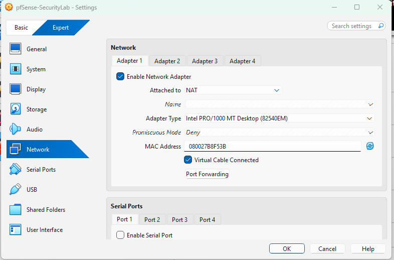

### Screenshot 02 — pfSense LAN Adapter

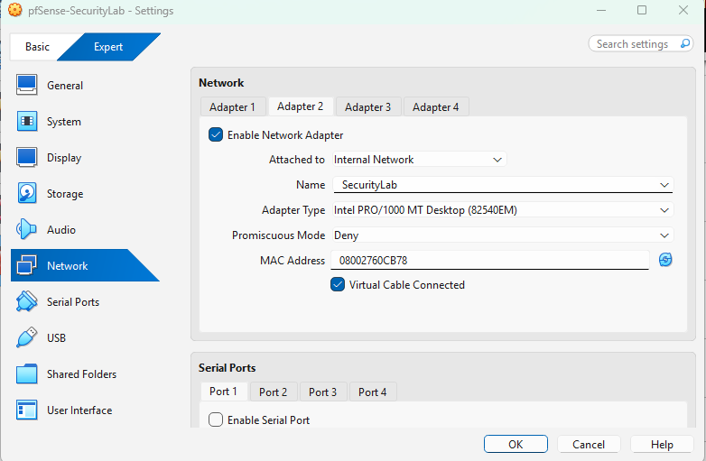

### Screenshot 03 — pfSense Interface Status

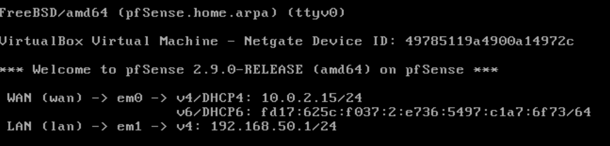

## 1.2 Ubuntu Network Verification

Used Linux networking commands to verify Ubuntu's IP address, default gateway, and connectivity to pfSense.

**Commands used:**

- `ip -br addr` — Display network interfaces and assigned IP addresses.
- `ip route` — Display the routing table.
- `ping -c 4 192.168.50.1` — Test connectivity to the pfSense gateway.

Ubuntu received `192.168.50.100/24` and used `192.168.50.1` as its default gateway through DHCP.

The ICMP test confirmed successful gateway connectivity with 0% packet loss.

### Screenshot 04 — Ubuntu Network Interfaces

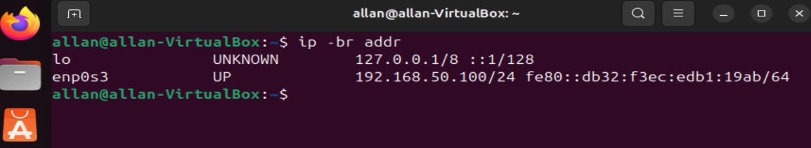

### Screenshot 05 — Ubuntu Routing Table

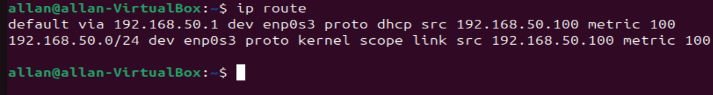

### Screenshot 06 — Ubuntu to pfSense Connectivity

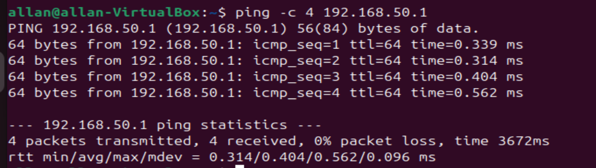

## 1.3 Kali Linux Network Verification

Verified Kali's two VirtualBox network adapters.

- `eth0`: NAT interface.
- `eth1`: SecurityLab interface.

Kali received `192.168.50.101/24` on its SecurityLab interface.

A ping test confirmed communication between Kali and Ubuntu with 0% packet loss.

### Screenshot 07 — Kali VirtualBox Network Configuration

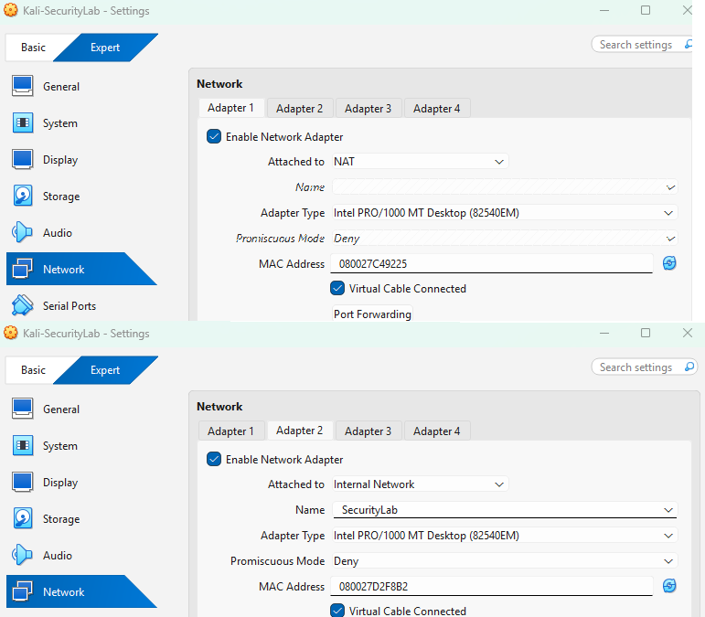

### Screenshot 08 — Kali Network Interfaces

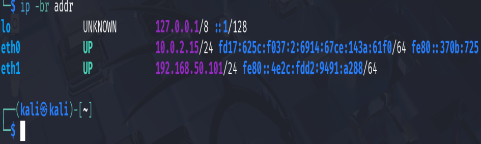

### Screenshot 09 — Kali to Ubuntu Connectivity

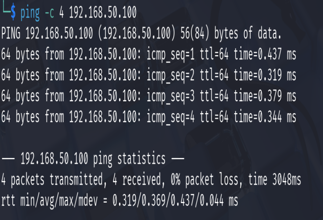

## 1.4 Routing Investigation

Investigated Kali's routing behavior using:

- `ip route`
- `ip route get 1.1.1.1`
- `ip route get 192.168.50.100`

The routing table showed two default gateways, with the lower-metric NAT route preferred for general outbound traffic.

Results confirmed:

- Traffic to `1.1.1.1` used `eth0` through VirtualBox NAT.
- Traffic to Ubuntu used `eth1` through SecurityLab.

**Key finding:** Kali's separate NAT interface could bypass pfSense for outbound internet traffic. Therefore, later firewall-blocking experiments used Ubuntu, which routed through pfSense.

### Screenshot 10 — Kali Routing Table

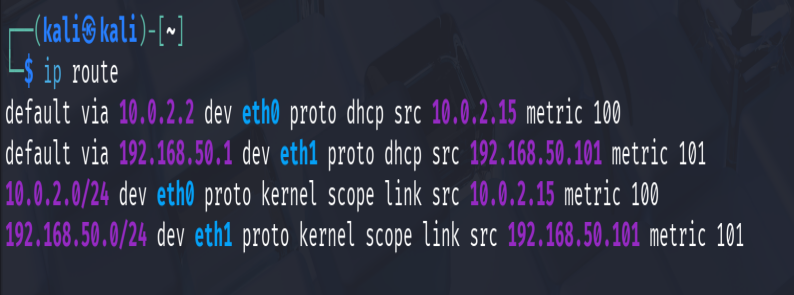

### Screenshot 11 — Kali Internet Route Selection

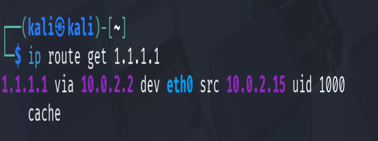

### Screenshot 12 — Kali to Ubuntu Route Selection

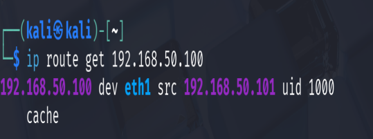

---

# Phase 2 — ICMP Traffic Analysis with Wireshark

## 2.1 Preparing Wireshark

Verified Wireshark installation on Kali and started a packet capture on `eth1`.

**Command used:** `wireshark --version`

The installed Kali Wireshark version was 4.6.0.

### Screenshot 13 — Wireshark Version

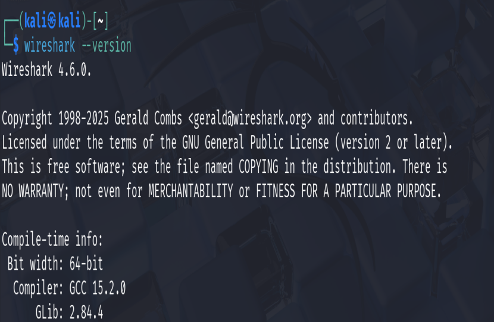

### Screenshot 14 — Live Packet Capture on eth1

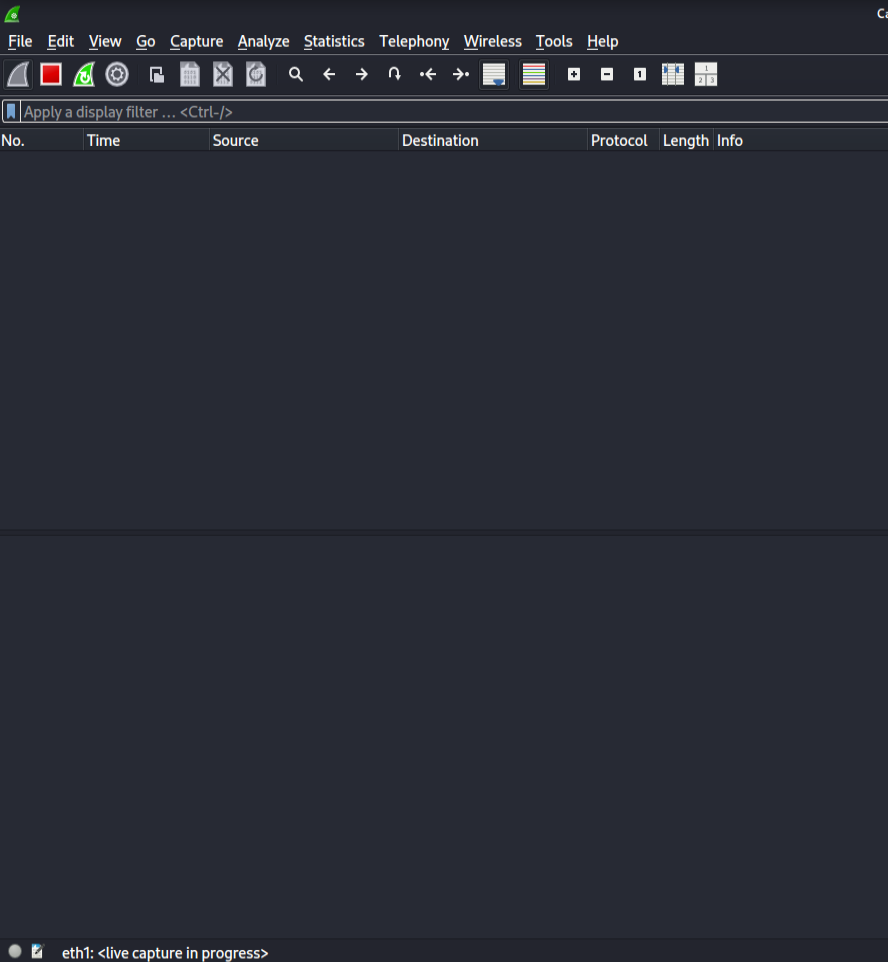

## 2.2 Generating ICMP Traffic

Generated controlled ICMP traffic from Kali to Ubuntu.

**Command:** `ping -c 4 -I eth1 192.168.50.100`

**Wireshark display filter:** `icmp && ip.addr == 192.168.50.100`

The capture showed four ICMP Echo Requests and four corresponding Echo Replies.

### Screenshot 15 — ICMP Request and Reply Capture

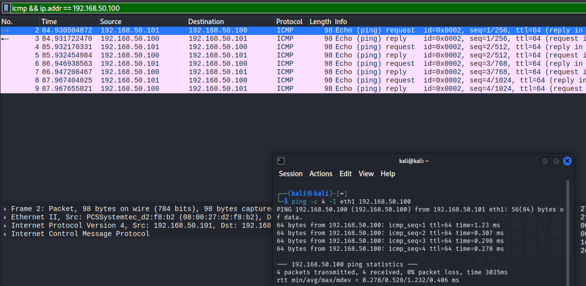

## 2.3 ICMP Packet Inspection

Examined individual ICMP packets and their IPv4 headers.

| Field | Echo Request | Echo Reply |
|---|---|---|
| Source | Kali | Ubuntu |
| Destination | Ubuntu | Kali |
| ICMP Type | 8 | 0 |
| ICMP Code | 0 | 0 |
| Identifier | 2 | 2 |
| Sequence Number | 1 | 1 |

The matching Identifier and Sequence Number allowed Wireshark to associate an Echo Request with its corresponding Echo Reply.

### Screenshot 16 — ICMP Echo Request Details

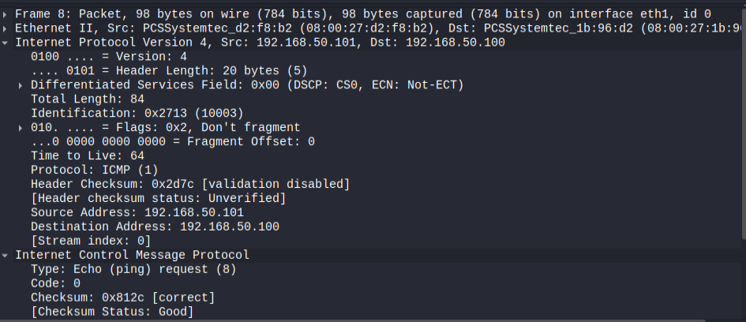

### Screenshot 17 — ICMP Echo Reply Details

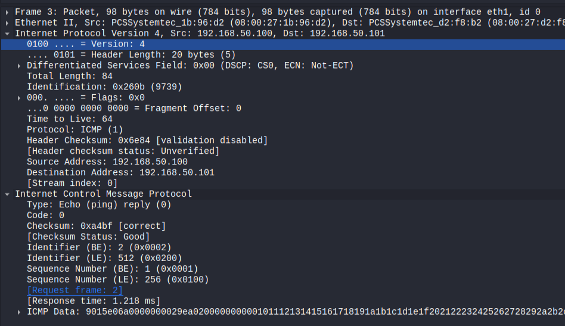

### Screenshot 18 — ICMP Request and Reply Comparison

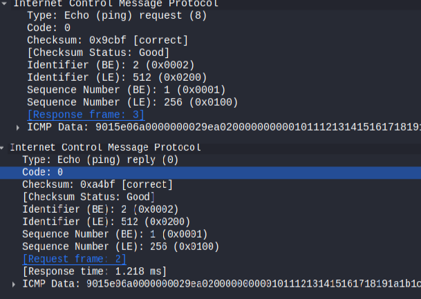

**Key finding:** ICMP packet analysis revealed the direction of traffic, response timing, and matching request/reply information.

---

# Phase 3 — TCP Three-Way Handshake Analysis

## 3.1 Troubleshooting an Nginx Service Failure

Before generating HTTP traffic, I checked the Nginx service on Ubuntu.

**Command:** `systemctl status nginx`

Nginx failed to start because it could not bind to TCP port 80.

I investigated the port using:

`sudo ss -ltnp '( sport = :80 )'`

The result revealed that Apache2 was already listening on port 80, preventing Nginx from using the same address and port.

### Screenshot 19 — Nginx Service Failure

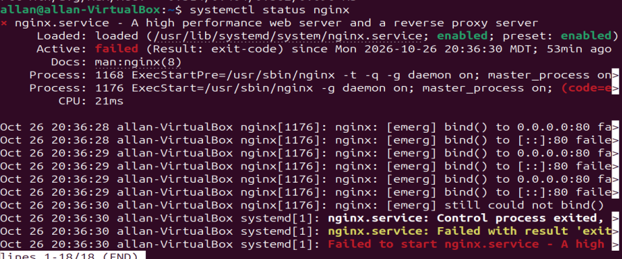

### Screenshot 20 — Port 80 Investigation

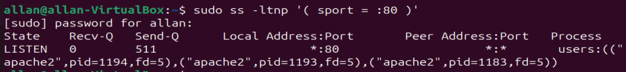

## 3.2 Resolving the Port Conflict

Stopped Apache2 temporarily using:

`sudo systemctl stop apache2`

Verified its status using:

`systemctl is-active apache2`

The service returned `inactive`.

Started Nginx using:

`sudo systemctl start nginx`

Verified Nginx was active, then confirmed it was listening on TCP port 80.

### Screenshot 21 — Apache2 Stopped

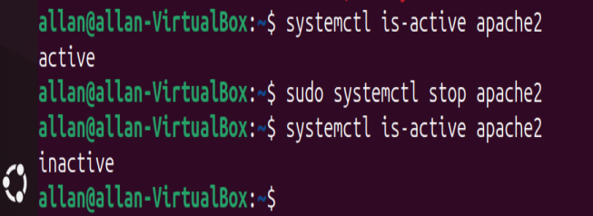

### Screenshot 22 — Nginx Service Restored

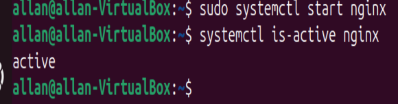

### Screenshot 23 — Nginx Listening on Port 80

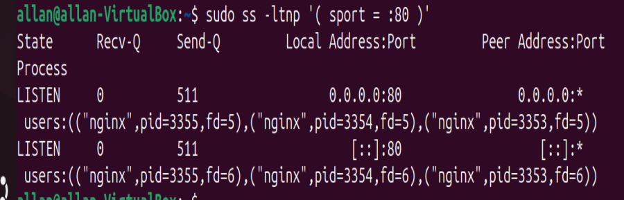

**Troubleshooting outcome:** Identified a port-binding conflict, isolated the competing service, and restored Nginx without reinstalling either application.

## 3.3 Capturing a Successful TCP Connection

Started a Wireshark capture on Kali's `eth1` interface.

**Display filter:** `tcp && ip.addr == 192.168.50.100 && tcp.port == 80`

Generated an HTTP request from Kali:

`curl -i http://192.168.50.100`

The request succeeded with `HTTP/1.1 200 OK`.

Wireshark captured the TCP three-way handshake.

| Step | Source | TCP Flags | Purpose |
|---|---|---|---|
| 1 | Kali | SYN | Initiate connection |
| 2 | Ubuntu | SYN-ACK | Acknowledge and respond |
| 3 | Kali | ACK | Complete handshake |

### Screenshot 24 — TCP Capture Ready

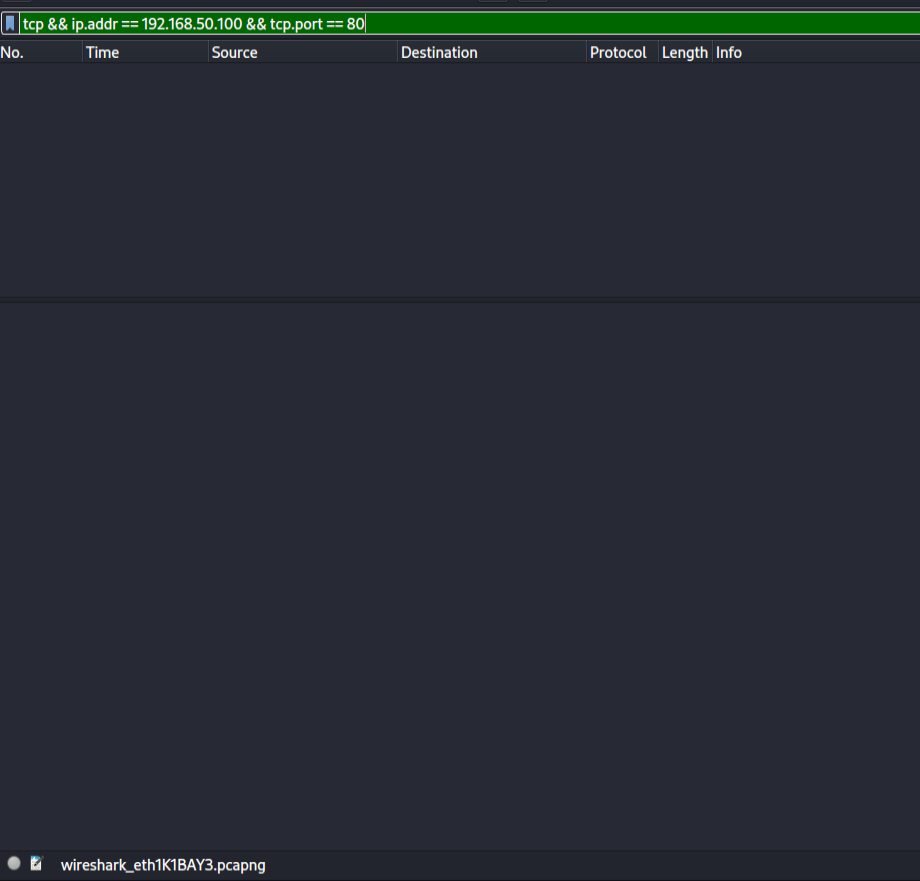

### Screenshot 25 — Successful TCP Three-Way Handshake

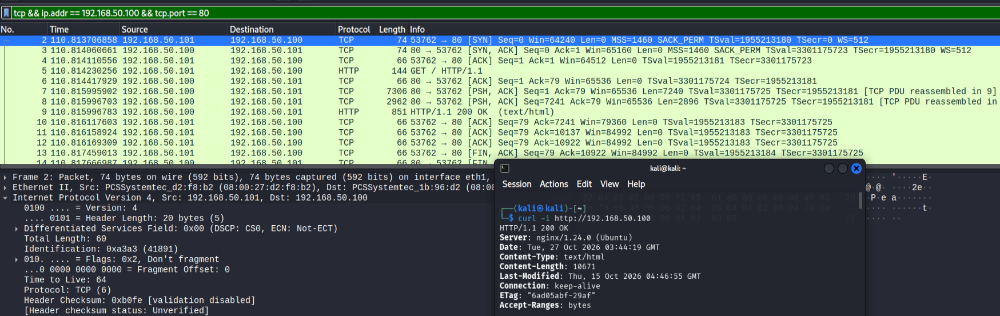

## 3.4 TCP Flag Investigation

Inspected the TCP flags for each handshake packet.

### Screenshot 26 — SYN Flag

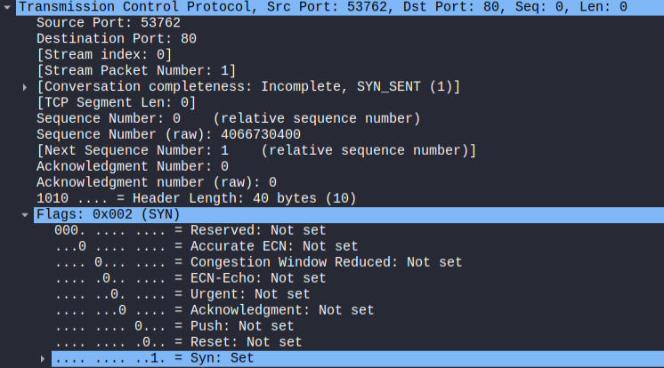

The initial SYN packet requested a connection.

### Screenshot 27 — SYN-ACK Flags

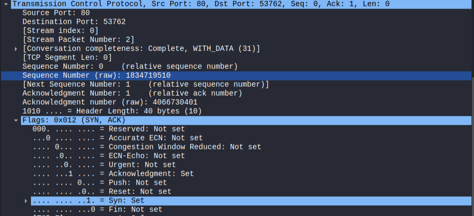

Ubuntu acknowledged Kali's request and sent its own SYN.

### Screenshot 28 — Final ACK Flag

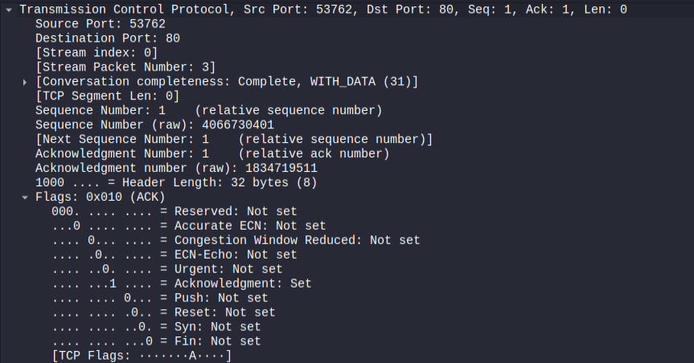

Kali acknowledged Ubuntu's SYN, completing the handshake.

**Key finding:** The SYN, SYN-ACK, and ACK flags demonstrate how a TCP connection is established before HTTP data is exchanged.

---

# Phase 4 — Investigating a Refused TCP Connection

## 4.1 Checking TCP Port 8080

To compare successful and unsuccessful connections, I investigated an unused TCP port on Ubuntu.

**Command:** `sudo ss -ltnp '( sport = :8080 )'`

The command showed no process listening on port 8080.

### Screenshot 29 — Port 8080 Listener Investigation

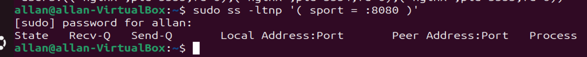

## 4.2 Capturing the Connection Attempt

Started a new Wireshark capture on Kali's `eth1` interface and configured a TCP port 8080 display filter.

### Screenshot 30 — Port 8080 Capture Ready

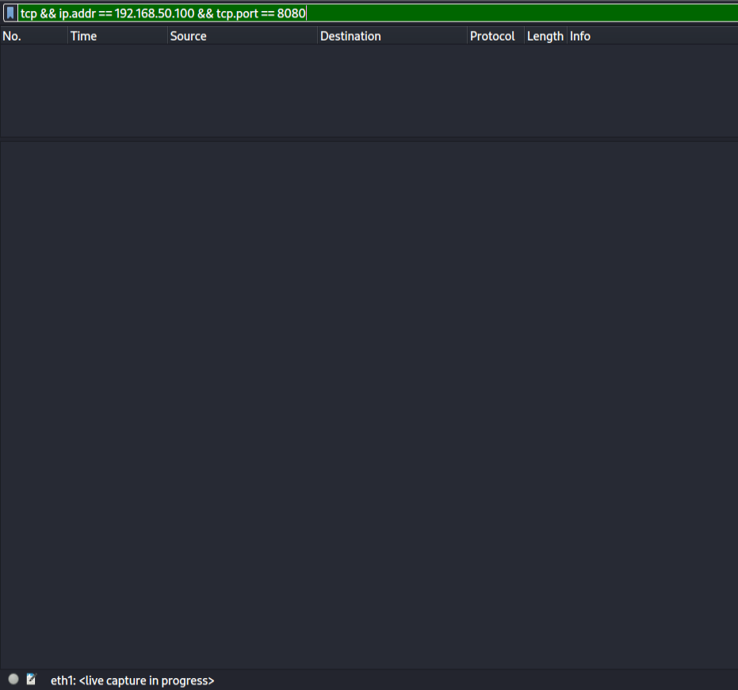

Generated the connection attempt from Kali:

`curl -v --connect-timeout 5 http://192.168.50.100:8080`

The terminal returned **Connection refused**.

Wireshark showed:

1. Kali sending a TCP SYN.
2. Ubuntu responding with RST-ACK.

Because no application was listening on port 8080, Ubuntu's operating system rejected the connection.

### Screenshot 31 — TCP Connection Refused

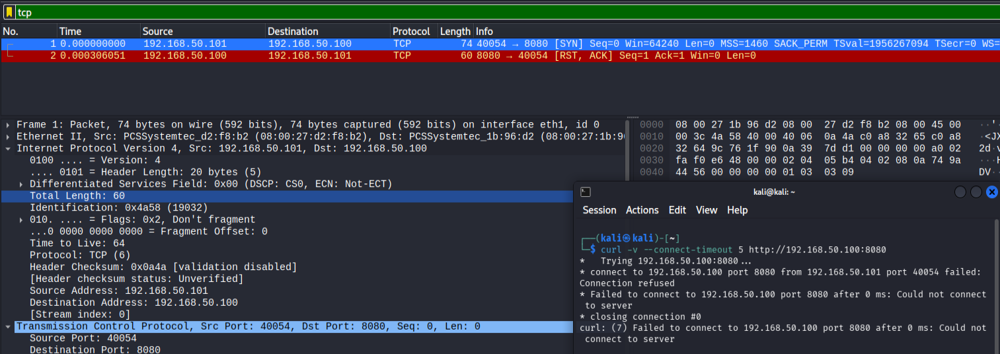

## 4.3 Inspecting the Reset Flag

Examined the TCP reset response in Wireshark.

| Flag | Value |
|---|---|
| RST | 1 |
| ACK | 1 |
| SYN | 0 |

The RST-ACK response indicated that Ubuntu actively refused the connection.

### Screenshot 32 — TCP Reset Flag Analysis

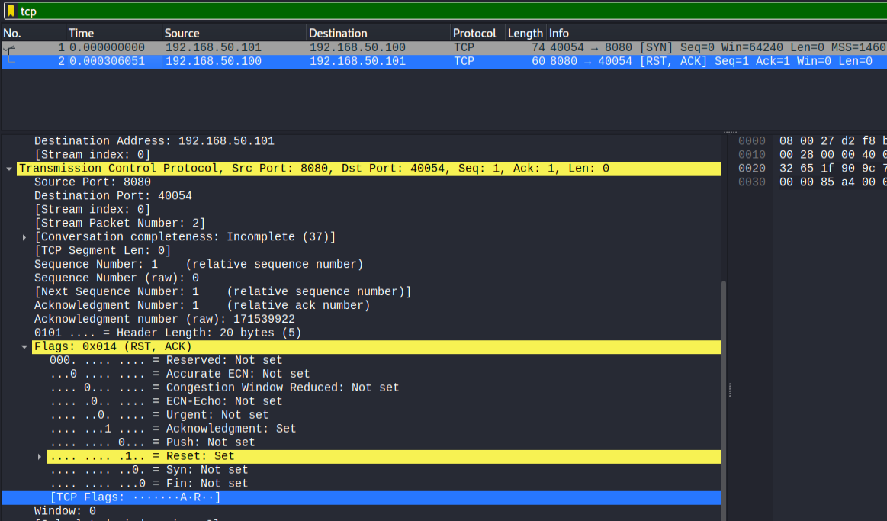

**Key finding:** A refused connection differs from a timeout. A TCP RST provides an immediate response, while silently dropped packets may cause repeated attempts and eventual timeout.

---

# Phase 5 — pfSense Firewall Configuration and Troubleshooting

## 5.1 Reviewing Existing Firewall Rules

Accessed **Firewall → Rules → LAN** in pfSense.

Reviewed existing rules from the previous project, including a disabled ICMP blocking rule.

The default LAN allow rule remained enabled.

### Screenshot 33 — Existing LAN Firewall Rules

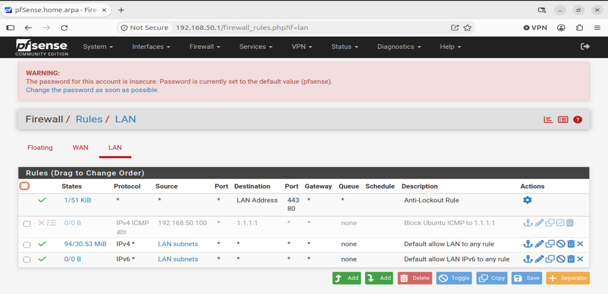

## 5.2 Administrator Account Hardening

Updated the pfSense administrator password to replace the default credentials.

Verified access to the management interface afterward and confirmed the default-password warning was no longer displayed.

### Screenshot 34 — Administrator Password Secured

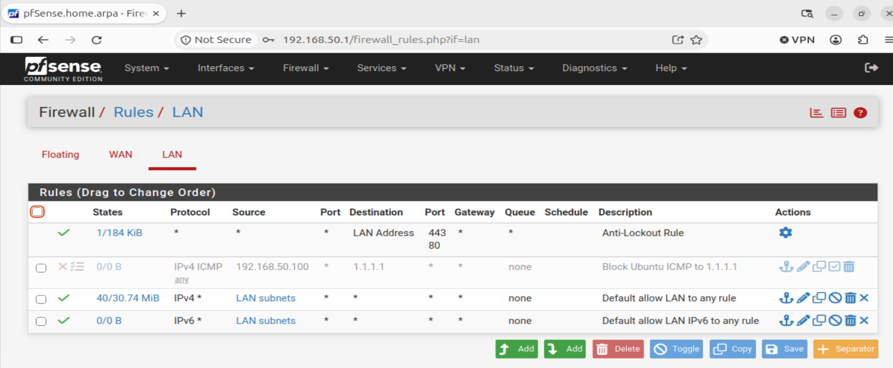

## 5.3 Creating an HTTP Blocking Rule

Created a narrowly scoped firewall rule intended to block outbound HTTP traffic from Ubuntu to `1.1.1.1`.

**Intended configuration:**

| Setting | Value |
|---|---|
| Interface | LAN |
| Action | Block |
| Address Family | IPv4 |
| Protocol | TCP |
| Source | 192.168.50.100/32 |
| Destination | 1.1.1.1/32 |
| Destination Port | 80 |
| Logging | Enabled |
| Description | Part 3 - Block Ubuntu HTTP to 1.1.1.1 |

The rule was placed above the default LAN allow rule.

### Screenshot 35 — Source Configuration

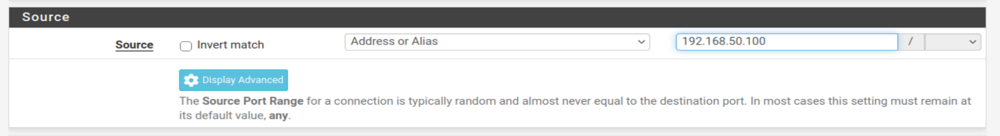

### Screenshot 36 — Destination Configuration

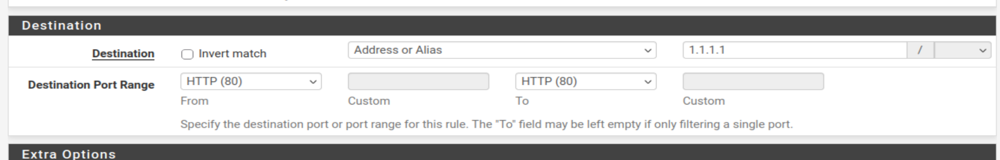

### Screenshot 37 — Firewall Logging Configuration

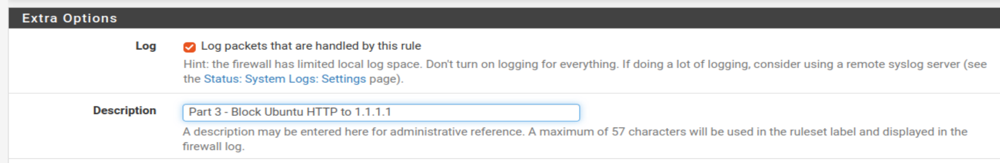

### Screenshot 38 — Initial Firewall Rule

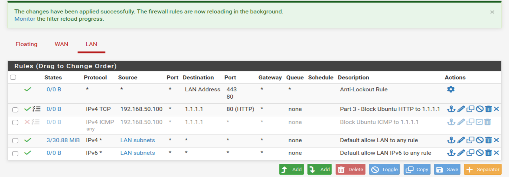

**Important troubleshooting note:** Although the rule was described as a blocking rule, subsequent testing revealed that its actual Action was initially set to Pass.

This misconfiguration became part of the firewall troubleshooting investigation.

## 5.4 Investigating Unexpected HTTP Connectivity

Tested outbound HTTP connectivity from Ubuntu.

**Command:** `curl -4 -v --connect-timeout 5 --noproxy '*' http://1.1.1.1`

Unexpectedly, the request succeeded.

The remote server returned:

`HTTP/1.1 301 Moved Permanently`

Because the intended firewall policy was to block the connection, this result required further investigation.

### Screenshot 39 — Unexpected Successful HTTP Connection

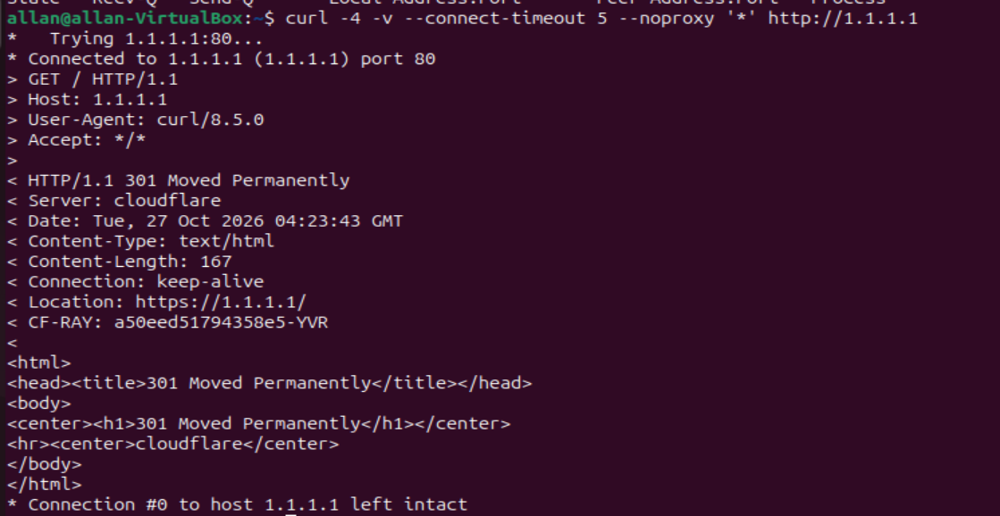

## 5.5 Verifying the Network Route

Checked Ubuntu's route to the target destination.

**Command:** `ip route get 1.1.1.1`

Confirmed that Ubuntu used `192.168.50.1` as its gateway.

This verified that the connection was routed through pfSense rather than bypassing the firewall through another Ubuntu interface.

### Screenshot 40 — Routing Investigation

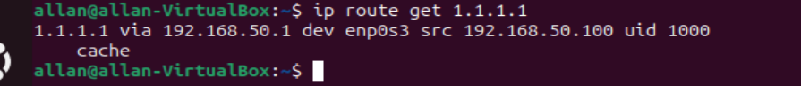

## 5.6 Investigating Firewall States

Navigated to **Diagnostics → States**.

Searched for existing states involving `1.1.1.1`.

No matching states were present at the time of inspection. Because the earlier HTTP session had already ended, this did not establish whether a state had existed during the connection.

### Screenshot 41 — Firewall State Investigation

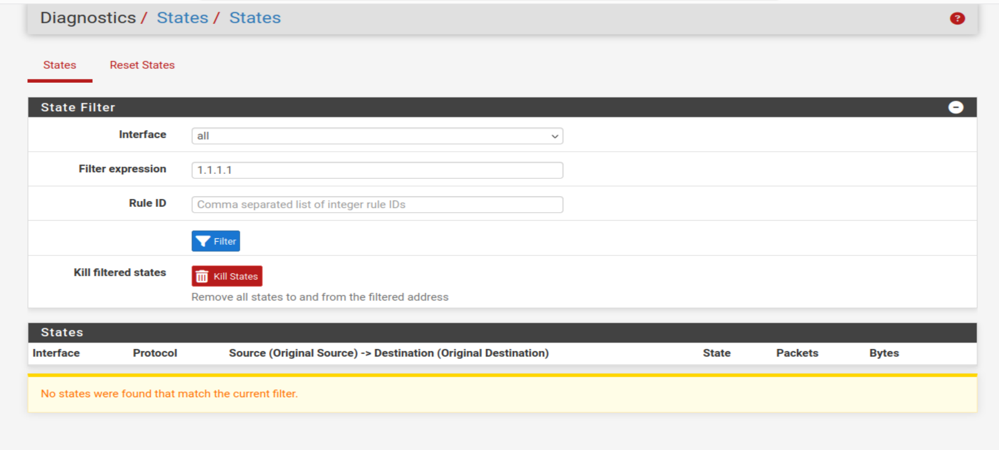

## 5.7 Investigating Firewall Logs

Reviewed firewall logs under:

**Status → System Logs → Firewall**

The logs revealed a permitted TCP SYN packet associated with the rule labeled:

`Part 3 - Block Ubuntu HTTP to 1.1.1.1`

Further inspection of the rule confirmed that the Action field had been set to **Pass**, despite its description.

### Screenshot 42 — Firewall Log Investigation

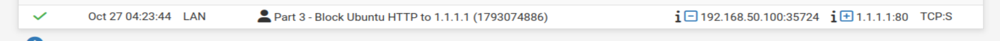

## 5.8 Correcting the Firewall Rule

Changed the rule Action from Pass to Block.

Saved and applied the updated configuration.

Verified the blocking rule remained above the default allow rule.

### Screenshot 43 — Corrected Firewall Rule

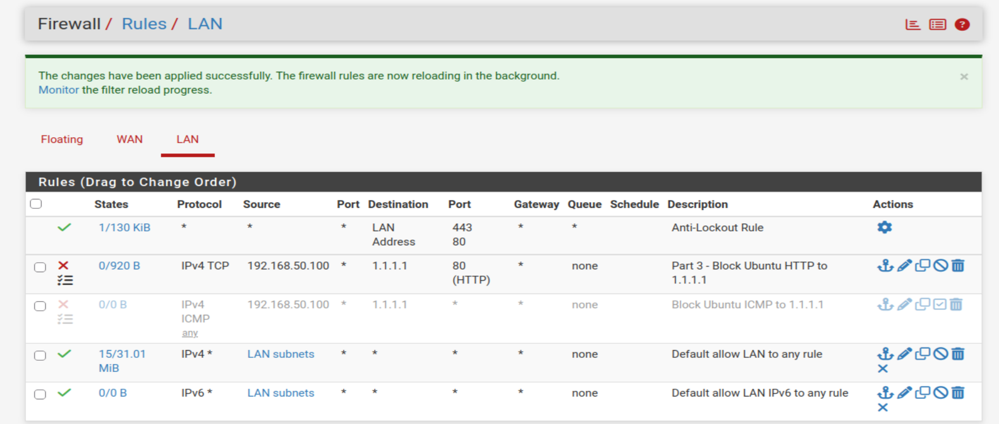

**Troubleshooting finding:** Firewall descriptions do not determine enforcement behavior. The actual Action setting controls whether matching traffic is permitted, blocked, or rejected.

## 5.9 Verifying the HTTP Block

Repeated the Ubuntu HTTP connection test.

**Command:** `curl -4 -v --connect-timeout 5 --noproxy '*' http://1.1.1.1`

The connection now timed out after approximately five seconds.

Unlike the earlier successful HTTP response, Ubuntu was unable to complete the TCP handshake.

### Screenshot 44 — HTTP Connection Blocked

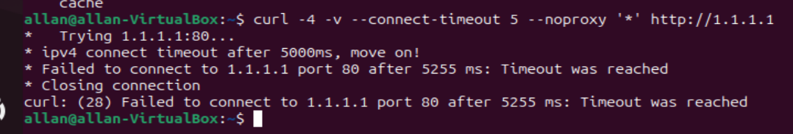

## 5.10 Correlating Firewall Logs

Returned to the pfSense firewall logs.

The logs showed blocked TCP SYN packets from Ubuntu to `1.1.1.1:80`.

Repeated attempts using the same source port were consistent with TCP SYN retransmissions.

### Screenshot 45 — Firewall Block Log Confirmation

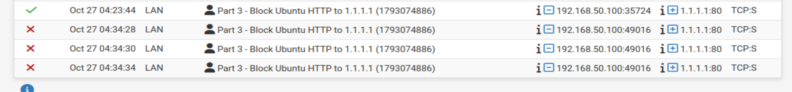

**Key finding:** The terminal timeout, corrected firewall configuration, and blocked log entries provided independent evidence that the intended firewall rule was enforcing the policy.

---

# Phase 6 — pfSense Packet Capture and SYN Retransmission Analysis

## 6.1 Configuring pfSense Packet Capture

Navigated to **Diagnostics → Packet Capture**.

Selected the LAN interface (`em1`) and configured a capture filter targeting traffic between Ubuntu and `1.1.1.1` on TCP port 80.

The capture was designed to isolate the traffic associated with the firewall-blocking experiment.

### Screenshot 46 — Packet Capture Configuration

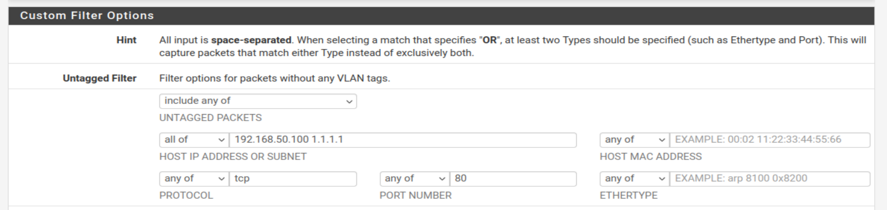

## 6.2 Capturing Blocked Connection Attempts

Started the pfSense LAN packet capture.

Repeated the Ubuntu HTTP request to `1.1.1.1`.

Stopped the capture after the connection attempt timed out.

The capture displayed five outgoing TCP packets from Ubuntu toward the destination using the same source port.

### Screenshot 47 — pfSense TCP Packet Capture

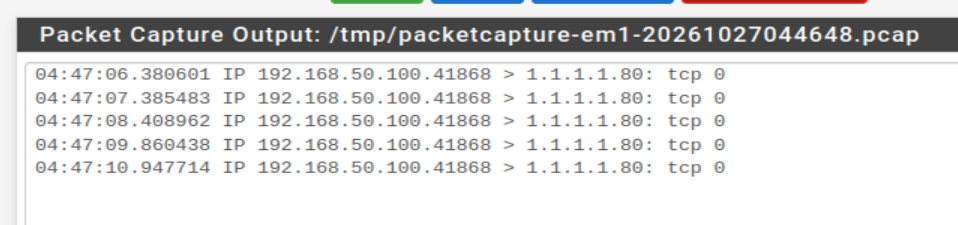

## 6.3 Analyzing the Capture in Wireshark

Downloaded the pfSense packet capture and opened it using Wireshark on Ubuntu.

Applied a display filter:

`ip.addr == 1.1.1.1 && tcp.port == 80`

The packet list showed repeated TCP SYN packets from `192.168.50.100` to `1.1.1.1:80`.

Packet inspection confirmed:

- SYN flag set.
- ACK flag not set.
- No corresponding SYN-ACK packets in the captured traffic.
- Multiple SYN attempts associated with the same connection.

### Screenshot 48 — TCP SYN Retransmission Analysis

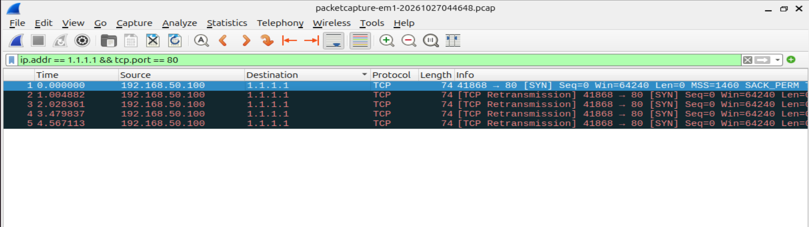

**Key finding:** The packet capture showed Ubuntu repeatedly attempting to establish a TCP connection while pfSense firewall logs recorded the matching blocked traffic.

This demonstrated how packet captures and firewall logs can be correlated to investigate a network connectivity problem.

---

# Investigation Results

## Comparing TCP Connection Behaviors

| Scenario | Observed Packets | Application Result | Explanation |
|---|---|---|---|
| Successful HTTP connection | SYN → SYN-ACK → ACK | HTTP 200 OK | Connection established |
| Closed TCP port | SYN → RST-ACK | Connection refused | No listening service |
| pfSense Block rule | Repeated SYN, no SYN-ACK | Connection timeout | Firewall silently dropped matching traffic |

### Lessons Learned

**1. Firewall configuration must be tested.**

Creating a rule with a description indicating Block does not guarantee it actually blocks traffic. The Action, protocol, addresses, ports, and rule order must be verified.

**2. Connection errors provide different clues.**

A connection refusal and a timeout may appear similar to an end user, but they can indicate different underlying causes.

**3. TCP flags reveal connection behavior.**

SYN, SYN-ACK, ACK, and RST provide useful information when investigating connectivity issues.

**4. Packet captures and logs complement each other.**

Wireshark reveals individual packets and TCP flags. Firewall logs help identify how a firewall processed matching traffic.

**5. Routing determines what a firewall can inspect.**

Traffic that bypasses pfSense cannot be monitored or filtered through its LAN firewall rules.

**6. Linux service troubleshooting requires identifying the root cause.**

Nginx could not start because Apache2 already occupied port 80. Inspecting listening sockets identified the problem without requiring a reinstall.

**7. An investigation should follow evidence, not assumptions.**

The unexpected successful HTTP request led to additional routing, state table, and firewall log checks before the misconfigured Action was identified and corrected.

---

# Tools and Technical Skills Demonstrated

| Category | Tools / Skills |
|---|---|
| Virtualization | Oracle VirtualBox |
| Firewall Administration | pfSense 2.9.0 |
| Operating Systems | Ubuntu Linux, Kali Linux |
| Network Analysis | Wireshark, pfSense Packet Capture |
| Network Troubleshooting | ping, ip route, ip route get |
| Linux Administration | systemctl, ss |
| HTTP Testing | curl |
| Protocol Analysis | IPv4, ICMP, TCP, HTTP |
| TCP Analysis | SYN, SYN-ACK, ACK, RST, retransmissions |
| Security Monitoring | Firewall logs, traffic filtering, rule validation |
| Troubleshooting | Routing analysis, service conflicts, firewall misconfiguration |

## Relevance to IT Support and Cybersecurity

This project provided practical experience with tasks relevant to entry-level IT Support, Network Technician, and Junior SOC Analyst responsibilities.

These include:

- Troubleshooting network connectivity.
- Identifying incorrect firewall configurations.
- Investigating Linux services and TCP ports.
- Reading routing tables and network interface information.
- Understanding normal and unsuccessful TCP connections.
- Analyzing network packets using Wireshark.
- Correlating system behavior with firewall logs.
- Documenting technical findings and validated resolutions.

## Security and Lab Scope

All firewall configuration, controlled packet generation, and security testing were performed within my own VirtualBox homelab.

The project used lab-owned virtual machines and ordinary HTTP requests to a specified external destination for outbound firewall-rule verification.

No third-party systems were scanned or attacked.

## Project Outcome

Successfully configured and verified the pfSense security lab, analyzed ICMP and TCP traffic, restored a failed Nginx service, investigated TCP connection failures, and identified and corrected a firewall rule misconfiguration.

The final investigation correlated three forms of evidence:

**Application timeout → pfSense firewall block logs → Wireshark SYN retransmissions**

This project strengthened my understanding of TCP/IP networking, firewall behavior, Linux troubleshooting, packet inspection, and structured security investigations.

---

**Project:** pfSense Security Homelab — Part 3

**Documentation:** 48 chronological screenshots

**Status:** Completed

**Focus:** Practical networking, firewall security monitoring, and network traffic analysis
